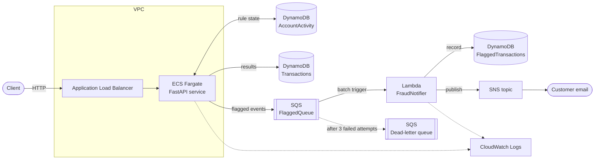

# Banking Fraud Detection & Customer Notification System

A cloud-native system on AWS that evaluates banking transactions in real time, flags suspicious ones, and notifies the customer. A REST API on ECS Fargate scores each transaction against fraud rules; flagged transactions are published to SQS, where a Lambda function records them in DynamoDB and sends an alert through SNS. All infrastructure is defined with AWS CDK (Python).

## Architecture



| Component | Role |
|---|---|
| **ALB** | Public entry point; health-checks the API on `/health` and routes traffic to healthy tasks |
| **ECS Fargate (FastAPI)** | Validates transactions, runs the fraud rules, stores results, publishes flagged events |
| **DynamoDB `AccountActivity`** | Per-account rule state: last known location and time, recent failed logins |
| **DynamoDB `Transactions`** | Every evaluation result, for lookup by transaction ID |
| **SQS `FlaggedQueue`** | Decouples detection from notification; buffers events if the Lambda is slow or failing |
| **SQS dead-letter queue** | Holds messages that failed processing 3 times, for inspection |
| **Lambda `FraudNotifier`** | Records flagged transactions and sends customer alerts |
| **DynamoDB `FlaggedTransactions`** | Permanent record of flagged transactions for audit and analytics |
| **SNS topic** | Delivers the customer alert by email |
| **CloudWatch Logs** | Logs from the API container and the Lambda |

### Request flow

1. A client sends `POST /transactions` to the ALB, which forwards it to a Fargate task.
2. The API loads the account's history from `AccountActivity` and runs every fraud rule.
3. The result (`approved` or `flagged`, with reasons) is saved to `Transactions` and the account's last-seen location is updated.
4. If flagged, the API publishes an event to SQS and returns immediately. The client never waits for the notification.
5. SQS triggers the Lambda, which stores the event in `FlaggedTransactions` and publishes an alert to SNS.

In testing, the time from the API flagging a transaction to the Lambda sending the alert was under one second, including a cold start.

## Fraud detection logic

Every transaction is checked against all rules. If any rule fires, the transaction is `flagged`, and the response lists **all** reasons that fired, not just the first, so investigators see the full picture.

The rules are pure functions in `api/app/rules.py` with no AWS calls, so each is unit-tested in isolation.

### 1. Large withdrawal: `LARGE_WITHDRAWAL`

Flags a **withdrawal** whose amount is greater than the threshold (default **$5,000**). Deposits are never flagged by this rule, because receiving money is not a fraud risk to the customer. An amount exactly equal to the threshold is approved.

### 2. Impossible travel: `IMPOSSIBLE_TRAVEL`

Compares the transaction's location with the account's last known location. The great-circle distance between the two points (haversine formula) is divided by the time between them. If the implied speed exceeds **900 km/h**, roughly airliner speed, the transaction is flagged.

- Moves shorter than **50 km** are ignored, so transactions across a city never trigger the rule.
- An account with no history is never flagged by this rule.
- Example: Toronto → Montreal (~500 km) in 2 hours is about 250 km/h and approved. Toronto → London (~5,700 km) in 10 minutes is about 34,000 km/h and flagged.

This is more precise than "different region within a time window": a cross-border transaction near a border is fine, while two cities far apart in the same country within minutes is not.

### 3. Excessive failed logins: `EXCESSIVE_FAILED_LOGINS`

Flags a transaction if the account had **3 or more failed login attempts** in the **15 minutes** before the transaction.

A successful login deliberately does **not** clear earlier failures. Several failures followed by a success and then a transaction is the classic account-takeover pattern. Old failures expire naturally once they fall outside the window.

### Thresholds

All thresholds are set through environment variables on the ECS task (see [Configuration](#configuration)), so they can be tuned without code changes.

### Known limitations

- **VPNs and travel**: a customer using a VPN, or a legitimate payment processed in another country, can trigger impossible travel. A production system would combine signals into a risk score instead of flagging on any single rule.
- **Static thresholds**: $5,000 is unusual for one customer and normal for another. Per-customer baselines, such as a multiple of the account's average withdrawal, would reduce false positives.
- **Concurrent requests**: two transactions for the same account arriving at the same instant may both be evaluated against the same history. This is acceptable for this scope.

## Data model

| Table | Key | Contents |
|---|---|---|
| `AccountActivity` | `account_id` + sort key `sk` | `sk = PROFILE`: last location and timestamp. `sk = LOGIN#<time>#<id>`: one item per failed login, deleted automatically by **DynamoDB TTL** after 24 hours |
| `Transactions` | `transaction_id` | Status and reasons for every evaluated transaction |
| `FlaggedTransactions` | `transaction_id`, plus GSI `by-account` (`account_id`, `flagged_at_ms`) | Full flagged transaction record and `notified` flag; the GSI supports "flagged transactions for this account, newest first" |

Implementation notes:

- Storing each failed login as its own item with a TTL avoids read-modify-write on a growing list. DynamoDB cleans up expired attempts on its own.
- Timestamps used in comparisons are stored as **epoch milliseconds**, because numbers compare reliably while ISO strings with different precision or timezone suffixes do not.
- The last-seen location is updated with a **conditional write** that only moves forward in time, so an out-of-order transaction can't overwrite newer data.

## Reliability

| Mechanism | What it protects against |
|---|---|
| **Idempotent Lambda** | SQS can deliver a message more than once. The Lambda writes the record only if it doesn't exist, and marks it `notified` only after the alert is sent. A duplicate is skipped; a crash between saving and notifying is retried without losing the alert. |
| **Partial batch failure** | If one message in a batch fails, only that message is retried, not the whole batch. |
| **Dead-letter queue** | A message that fails 3 times is moved to the DLQ instead of retrying forever. Verified by sending a malformed message. |
| **Visibility timeout (60s) > Lambda timeout (10s)** | A message is never handed to a second Lambda while the first is still processing it. |
| **Zero-downtime deploys** | `min_healthy_percent=100`: ECS starts the new task and waits until it is healthy before stopping the old one. |
| **Deployment circuit breaker** | A broken deployment is rolled back automatically instead of restarting a failing container indefinitely. |

## Security

- **Least-privilege IAM** (generated with CDK `grant_*` methods):
  - The API task role can read and write `AccountActivity` and `Transactions`, and can only **send** to the SQS queue.
  - The Lambda role can consume from the queue, read and write `FlaggedTransactions`, and publish to the one SNS topic.
  - Neither role can access any other resource.
- **Network**: the Fargate tasks' security group accepts traffic **only from the ALB**, so tasks can't be reached directly from the internet.
- **Container**: runs as a non-root user on a slim base image.
- **Encryption at rest**: SQS uses SQS-managed encryption; DynamoDB encrypts all tables by default.
- **No secrets in the repository**: the alert email is passed as an environment variable at deploy time.

**Not included in this version:** HTTPS on the ALB (requires a domain and ACM certificate) and API authentication. Both are covered under [Future improvements](#future-improvements).

## Project structure

```
fraud-detection/
├── api/                    # Transaction API (FastAPI)
│   ├── app/
│   │   ├── main.py         # Endpoints and dependency wiring
│   │   ├── models.py       # Request/response and event models
│   │   ├── rules.py        # Fraud rules (pure functions)
│   │   ├── config.py       # Thresholds from environment variables
│   │   ├── store.py        # In-memory and DynamoDB stores
│   │   └── events.py       # Logging and SQS publishers
│   ├── tests/              # Unit and API tests
│   ├── Dockerfile
│   ├── requirements.txt
│   └── requirements-dev.txt
├── lambda/
│   └── handler.py          # Notification Lambda
├── infra/                  # AWS CDK app (Python)
│   ├── app.py
│   └── infra/infra_stack.py
└── docs/
```

The API runs locally with no AWS dependencies: when the table and queue environment variables are not set, it uses an in-memory store and a logging publisher. On AWS, CDK sets those variables and the DynamoDB and SQS implementations are used.

## Deployment

### Prerequisites

- AWS account and the AWS CLI v2, configured with credentials (`aws sts get-caller-identity` should succeed)
- Node.js 22 or 24, and the AWS CDK CLI: `npm install -g aws-cdk`
- Python 3.12
- Docker Desktop, running (CDK builds the API image locally)

### Steps

1. **Bootstrap CDK**. This is needed once per account and region:

   ```bash
   cd infra
   python3.12 -m venv .venv
   source .venv/bin/activate
   pip install -r requirements.txt
   cdk bootstrap
   ```

2. **Set the alert email.** It must be set on **every** deploy; if it's missing, the deploy removes the email subscription.

   ```bash
   export ALERT_EMAIL=you@example.com
   ```

3. **Deploy**. The first deploy takes about 5 minutes.

   ```bash
   cdk deploy
   ```

4. **Confirm the email subscription.** AWS sends a "Subscription Confirmation" email; click **Confirm subscription**. Alerts are not delivered until this is done.

5. **Note the outputs.** The `ApiServiceServiceURL` output is the API's base URL. To print the outputs again later:

   ```bash
   aws cloudformation describe-stacks --stack-name FraudDetectionStack \
     --query "Stacks[0].Outputs" --output table
   ```

### Tear down

```bash
cd infra
cdk destroy
```

This deletes every resource, including the DynamoDB tables and their data.

### Running locally

```bash
cd api
python3.12 -m venv .venv
source .venv/bin/activate
pip install -r requirements-dev.txt
pytest -v                          # unit and API tests
uvicorn app.main:app --reload      # http://127.0.0.1:8000/docs
```

## Configuration

Environment variables on the API task:

| Variable | Default | Purpose |
|---|---|---|
| `LARGE_WITHDRAWAL_THRESHOLD` | `5000` | Withdrawals above this amount are flagged |
| `MAX_TRAVEL_SPEED_KMH` | `900` | Implied travel speed above this is flagged |
| `MIN_TRAVEL_DISTANCE_KM` | `50` | Moves shorter than this are ignored |
| `FAILED_LOGIN_LIMIT` | `3` | Failed logins needed to flag a transaction |
| `FAILED_LOGIN_WINDOW_MINUTES` | `15` | How far back failed logins count |
| `ACCOUNT_ACTIVITY_TABLE`, `TRANSACTIONS_TABLE` | set by CDK | DynamoDB tables; in-memory store if unset |
| `FLAGGED_QUEUE_URL` | set by CDK | SQS queue; events are logged if unset |

## API usage

Interactive documentation is available at `<base URL>/docs` (Swagger UI).

### `POST /transactions`

Evaluates a transaction.

**Request**

```json
{
  "account_id": "acc-123",
  "amount": 9000,
  "transaction_type": "withdrawal",
  "location": {
    "city": "Toronto",
    "country": "CA",
    "latitude": 43.65,
    "longitude": -79.38
  },
  "timestamp": "2026-10-08T12:00:00Z"
}
```

| Field | Type | Rules |
|---|---|---|
| `account_id` | string | Required, non-empty |
| `amount` | number | Greater than 0 |
| `transaction_type` | string | `withdrawal`, `deposit`, or `transfer` |
| `location` | object | `city`, `country`, `latitude` (-90 to 90), `longitude` (-180 to 180) |
| `timestamp` | string | ISO 8601 **with a timezone** (for example `Z` or `+00:00`) |

**Response: `201 Created`**

```json
{
  "transaction_id": "7ab4e99d-c763-476c-8495-e6bea08c74ad",
  "status": "flagged",
  "reasons": ["LARGE_WITHDRAWAL"]
}
```

`status` is `approved` or `flagged`. `reasons` is empty when approved, otherwise any of `LARGE_WITHDRAWAL`, `IMPOSSIBLE_TRAVEL`, `EXCESSIVE_FAILED_LOGINS`.

**Example**

```bash
curl -X POST $URL/transactions -H "Content-Type: application/json" \
  -d '{"account_id":"acc-123","amount":9000,"transaction_type":"withdrawal","location":{"city":"Toronto","country":"CA","latitude":43.65,"longitude":-79.38},"timestamp":"2026-10-08T12:00:00Z"}'
```

### `GET /transactions/{transaction_id}`

Returns a previously evaluated transaction.

**Response: `200 OK`**, in the same format as `POST /transactions`. **`404 Not Found`** if the ID is unknown:

```json
{ "detail": "Transaction not found" }
```

### `POST /login-attempts`

Records a login attempt. Failed attempts feed the failed-login rule. In a real system these events would come from the authentication service; this endpoint simulates that.

**Request**

```json
{
  "account_id": "acc-123",
  "success": false,
  "timestamp": "2026-10-08T11:58:00Z"
}
```

**Response: `204 No Content`**

### `GET /health`

Health check used by the ALB.

**Response: `200 OK`**

```json
{ "status": "ok" }
```

### Errors

| Status | When |
|---|---|
| `422 Unprocessable Entity` | Invalid input: missing field, negative amount, unknown transaction type, timestamp without timezone. The body lists each problem under `detail`. |
| `404 Not Found` | Unknown transaction ID |

### Trying the scenarios

```bash
# Impossible travel: use a fresh account ID each run
ACC="acc-$(date +%s)"
curl -X POST $URL/transactions -H "Content-Type: application/json" \
  -d '{"account_id":"'$ACC'","amount":100,"transaction_type":"withdrawal","location":{"city":"Toronto","country":"CA","latitude":43.65,"longitude":-79.38},"timestamp":"2026-10-08T12:00:00Z"}'
curl -X POST $URL/transactions -H "Content-Type: application/json" \
  -d '{"account_id":"'$ACC'","amount":100,"transaction_type":"withdrawal","location":{"city":"London","country":"GB","latitude":51.51,"longitude":-0.13},"timestamp":"2026-10-08T12:10:00Z"}'
# Second response: "flagged", ["IMPOSSIBLE_TRAVEL"]

# Failed logins: three failures, then a transaction
for m in 01 02 03; do
  curl -X POST $URL/login-attempts -H "Content-Type: application/json" \
    -d '{"account_id":"'$ACC'-l","success":false,"timestamp":"2026-10-08T12:'$m':00Z"}'
done
curl -X POST $URL/transactions -H "Content-Type: application/json" \
  -d '{"account_id":"'$ACC'-l","amount":100,"transaction_type":"withdrawal","location":{"city":"Toronto","country":"CA","latitude":43.65,"longitude":-79.38},"timestamp":"2026-10-08T12:05:00Z"}'
# Response: "flagged", ["EXCESSIVE_FAILED_LOGINS"]
```

## Design decisions & tradeoffs

| Decision | Reasoning |
|---|---|
| **Public subnets, no NAT gateway** | A NAT gateway costs about $1/day even when idle. Tasks run in public subnets, but their security group only accepts traffic from the ALB. In production I'd use private subnets with a NAT gateway or VPC endpoints. |
| **ARM64 (Graviton) for Fargate and Lambda** | About 20% cheaper than x86, and matches the Apple Silicon development machine, so the image builds natively. |
| **SNS instead of SES** | New SES accounts are in sandbox mode and can only send to verified addresses. SNS works immediately. The subscribed email stands in for the customer's; in production the Lambda would look up the customer's contact details and send through SES or SMS. |
| **Pure rule functions behind `Store` and `EventPublisher` interfaces** | The rules are unit-tested without AWS, and the API runs locally with in-memory implementations. Moving to DynamoDB and SQS required no endpoint changes. |
| **On-demand DynamoDB billing** | No capacity planning; an idle table costs nothing. |
| **`RemovalPolicy.DESTROY` on tables** | Correct for a demo, so `cdk destroy` leaves nothing behind. Production tables would use `RETAIN`. |
| **Save result, then publish to SQS** | If SQS is unavailable, the client gets an error, but the result is already saved as flagged and no event was sent. The production fix is the transactional outbox pattern, or DynamoDB Streams feeding the queue. |

## Cost

While deployed, the stack costs roughly **$1 per day**, mostly the ALB and public IPv4 addresses. Lambda, SQS, SNS, and on-demand DynamoDB stay within free-tier or near-zero usage at test volumes. Run `cdk destroy` when not in use.

## Future improvements

- **JWT authentication**, so only authenticated customers can submit transactions. Within minutes of deployment, the API logs showed automated internet scanners probing the public endpoint.
- **HTTPS** on the ALB with an ACM certificate.
- **CloudWatch alarm** on flagged-transaction volume and on dead-letter queue depth.
- **Multi-tenant thresholds**: per-bank rule configuration stored in DynamoDB.
- **Kinesis Data Firehose to S3** for streaming flagged transactions into a data lake for machine learning.
- **Risk scoring** that combines signals instead of flagging on any single rule.